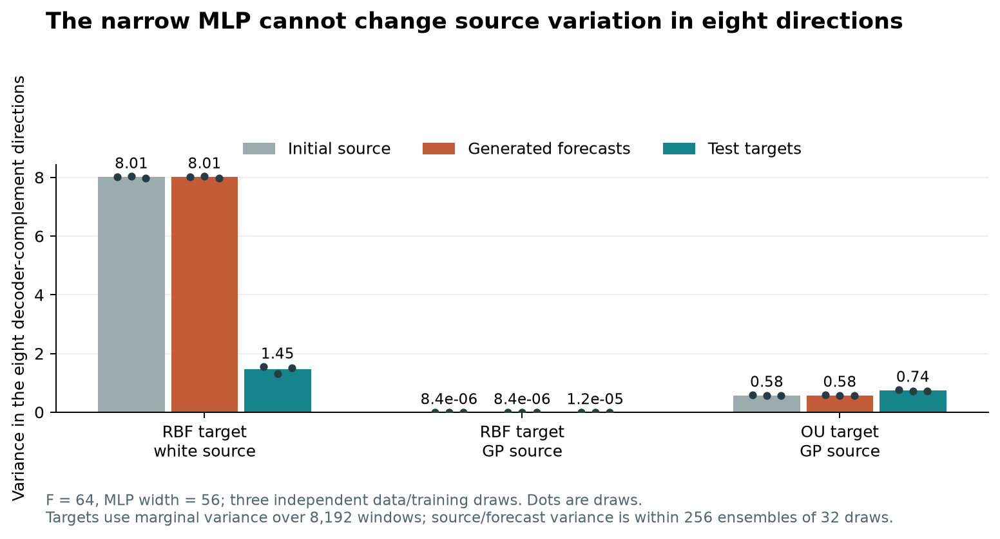

# Independent reproduction and code audit of the October 15 additions

Completed on 25 October 2026 against baseline commit `0333803e2563b38b98073b4ed2009c41e3889bfd`. No original result or numerical implementation was modified. No commit was made.

## What was independently reproduced

The arithmetic and saved checkpoints are reproducible. All **360 kernel-scan checkpoints** were evaluated on their complete independently reconstructed **8,192 test velocity pairs**, using CPU inference. An independent implementation reconstructs kernel covariances, chronological-independent GP draws, history normalization, source draws and time streams. The released model architecture and coordinate wrapper are reused to read the checkpoints. Both source-specific velocity PCA and fixed target PCA metrics are checked, including per-component and normalized errors, signal/tail group means, checkpoint identities and selected steps.

For **18 focused checkpoints**, the audit also regenerated the complete original **256 histories × 32 draws**, using an independently written 64-step Euler loop, plus **1,024 individual paths**. The cells are RBF/F64 with white and GP sources, MLP and S4, three draws; and OU/F64 with GP source, MLP and S4, three draws. Fair CRPS, energy score, interval coverage/width and forecast-mean errors were recomputed with independent NumPy formulas. These regenerated arrays are saved under `results/followup-reproduction/samples/`.

All **10,098 recorded checks passed**. Numerical agreement is much tighter than the declared tolerance (`rtol=1e-4`, `atol=1e-8`):

| Quantity | Largest absolute discrepancy | Largest relative discrepancy |
|---|---:|---:|
| PC1 velocity MSE, 360 fits | 4.42e-6 | 1.82e-7 |
| Residual velocity MSE, 360 fits | 2.69e-8 | 2.27e-7 |
| Mean fair CRPS, 18 fits | 1.46e-8 | 2.34e-8 |
| Individual-history fair CRPS, 18 fits | 4.34e-7 | 4.63e-7 |
| Generated-path roughness, 18 fits | 1.07e-8 | 8.78e-8 |

All 360 kernel checkpoint hashes match their records. All 24 ETTh1 normalization checkpoint hashes and all 24 corresponding forecast-array hashes also match. Frozen implementation hashes match both studies' manifests. The kernel repository omits all 360 original forecast archives; the focused 18 archives above were reconstructed, rather than falsely described as recovered byte-for-byte. Forecasts for the remaining 342 cells were not independently regenerated in this audit. No training was rerun for this reproduction.

## A concrete architectural confound at horizon 64

The original F64 MLP has a 64-by-56 final weight matrix. Its velocity is

`v(x,t,h) = W a(x,t,h) + b`.

Let the columns of `N` form an orthonormal basis perpendicular to the column span of `W`. For every time, state and history, `N.T @ v = N.T @ b`. Therefore Euler integration from time zero to one obeys

`N.T @ generated = N.T @ initial_source + N.T @ b`.

This is an exact global restriction of the architecture, not a numerical Jacobian-rank estimate or a claim about optimization. All nine focused MLP checkpoints have rank 56 and **eight immutable directions**. Reconstructed ensembles satisfy the identity with maximum absolute error **2.26e-6**, consistent with float32 integration error.

| Target / source | Initial-source variance | Generated variance | Test-target marginal variance |
|---|---:|---:|---:|
| RBF / white | 8.0074 | 8.0074 | 1.4545 |
| RBF / GP | 8.3730e-6 | 8.3730e-6 | 1.2469e-5 |
| OU / GP | 0.5758 | 0.5758 | 0.7367 |

Numbers are sums of variance in the eight directions, then means over three independent data/training draws. Source/forecast quantities are within-history ensemble variances; target marginal variance is over all 8,192 test windows. Marginal target variance includes variation between histories and is therefore an upper bound on average conditional target variance in any fixed projection. The directions depend on each trained model; this table does not claim the same projection across sources.

For RBF with white source, the theoretical source variance divided by test-target marginal variance is **5.16, 6.10 and 5.34** across the three draws. Excess spread survives exactly into the forecast. Thus the long-window white-source comparison mixes temporal architecture with a fixed decoder bottleneck. Wider-head controls are needed before interpreting its S4 advantage as evidence that temporal structure itself is responsible.

This particular dimension restriction does **not** apply to the original horizon-16 experiment: a width-56 output representation can span all 16 output coordinates. The F64 diagnosis must not be substituted for an explanation of the original F16 findings.



## Findings from the code and interpretation review

- **No sign, transpose or propagation error was found** in the original Gaussian Jacobian, PCA rotation or finite-Euler perturbation response. Their reference nevertheless conditions on full raw history, while networks see normalized history. A mismatch to this privileged reference does not itself identify an optimization failure. The separate normalized-history oracle follow-up addresses that information-set mismatch.
- **The LayerNorm structural-rank label needs qualification.** With positive epsilon, a width-56 final LayerNorm generically has exact rank 55, not 54. Rank 54 is an effective numerical rank or the epsilon-zero limit. A direct float64 derivative check gives final singular values approximately `0.9669, 9.04e-7, 3.44e-17`. This correction does not remove the stronger eight-dimensional fixed-decoder restriction above.
- **The ETTh1 normalization comparison is valid as a combined intervention.** It simultaneously changes level equivariance, scale weighting and the source distribution in physical coordinates. It does not isolate only one causal mechanism. Center-only, scale-only and raw-unit-loss controls are appropriate follow-ups.
- **Qualify the report's “no kernel or window gives S4 a material advantage.”** The kernel findings themselves document a white-source RBF/F64 residual-MSE ratio near 0.70. The negative general statement is defensible only within its declared GP-source endpoints. Likewise, “the mechanism exists” is stronger than a reference-Jacobian comparison alone establishes.
- **Signal/tail labels are index-based diagnostics.** The scan counts training-target components above a nugget threshold, then applies that count as a cutoff in each source's velocity-PCA basis. It does not prove that the same physical signal subspace is compared across sources, especially in near-isotropic white-source tails. Fixed-target-basis metrics should accompany those labels.
- **Two referenced documents are absent:** `docs/etth1_level_hypothesis.tex` and `docs/etth1_prior_level_protocol.md`. This is a documentation/reproducibility gap, not evidence that the saved ETTh1 outcomes are wrong.

## Scope check against the original assignment

The two original project PDFs require the GP-source velocity to have more than 90% of its energy in the first two training-PCA components, measured on held-out validation data after history normalization. Their optional real-data extension is conditional on that check. The ETTh1 factorial addresses the same source/head/geometry questions, but it must be identified as supplementary pipeline research rather than a qualifying instance of that optional task.

An independent post-hoc check uses only the established ETTh1 training and validation splits, the frozen five normalization pipelines, and five independently seeded source draws. No test forecasts or model scores enter the check and no run is selected or discarded. PCA is fitted on training velocity and projected validation variance determines the ratio.

| Pipeline | Validation target top-two energy | GP velocity top-two energy, five-draw range | White velocity top-two energy, five-draw range |
|---|---:|---:|---:|
| Global | 0.9578 | 0.9144–0.9404 | 0.2691–0.2965 |
| Center only | 0.8481 | 0.9013–0.9286 | 0.1369–0.1438 |
| Scale only | 0.9632 | 0.9582–0.9632 | 0.9033–0.9080 |
| History center + scale | 0.8082 | 0.8208–0.8510 | 0.6066–0.6210 |
| History + raw-unit loss | 0.8082 | 0.8208–0.8510 | 0.6066–0.6210 |

Thus the required history-normalized ETTh1 geometry fails the 0.90 GP gate in all five probes. Other pipelines change the geometry and cannot establish that the original normalization qualifies. Scale-only also makes white-source velocity strongly concentrated; its high GP ratio alone does not preserve the intended GP-versus-white contrast. These are descriptive scope checks with a finite validation period, not a new benchmark or a tuning procedure. Full evidence and source/configuration/dataset hashes are in `results/followup-reproduction/scope_geometry.json`.

The new F64 capacity controls are likewise supplementary tests of the specific long-window architectural explanation. They do not replace the original F16 Task 1–3 results or their recorded success flags. The F16 label intervention stays closest to the original geometry, but introduces an analytic conditional-mean teacher and oracle-based validation; it is a mechanism test rather than an available forecasting method.

The normalized-history oracle removes the original reference's extra access to raw location and scale. It still conditions on the complete normalized history before the network's encoder. Its discrepancy therefore does not isolate limitations of the head from limitations of the learned history representation, finite capacity or optimization.

## Reproduction commands and artifacts

```sh
.venv/bin/python scripts/audit_followup_reproduction.py --phase all
.venv/bin/python scripts/audit_followup_decoder_span.py
MPLCONFIGDIR=/tmp/fm-followup-mpl .venv/bin/python scripts/plot_followup_decoder_span.py
.venv/bin/python scripts/audit_followup_scope_geometry.py
```

Primary machine-readable evidence is `results/followup-reproduction/all_summary.json`, the per-run audits, `integrity.json` and `decoder_span.json`. `artifact_hashes.json` records hashes of the main audit scripts and delivered evidence. A separate independent checker, `scripts/check_followup_normalization.py`, validates the new normalization follow-up as its results become available; its partial and final status must not be confused with the completed audit of the original 360 fits.
